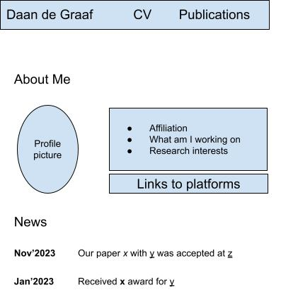

# Building my personal website
My personal website serves as an overview of my academic (or otherwise software related) work.

## Inspiration
I looked at the websites of former supervisors:
- [Burcu Kulahcioglu Ozkan](https://burcuku.github.io/home/): I like this website a lot, especially the news section. 
  I decided to also have a news section on the front page: it is flexible enough for lots of different content, and gives an idea of what I have been doing most recently.
- [Soham Chakraborty](https://www.st.ewi.tudelft.nl/sschakraborty/): I like the table for displaying publications with dates. I will use that for the news section too.

## Content
The most important is to give an overview of:
- My current affiliation
- What I am working on
- My research interests
- Recent news related to my research (e.g. publications accepted, awards received)
- Links to my profiles on other platforms (primarily my TU/e profile page, email, Google Scholar, GitHub, LinkedIn)

Next to that, I would also like to provide:
- My CV
- A list of my publications
- Blog posts, if I can get into the habit of writing them.

Here is the basic design for the front page:

## How *Not* To Build It 
Initially I built a very simple website using just HTML and [simplecss](https://simplecss.org/), but that has limitations:
- I have to write all the HTML manually. For longer bits of content, I would prefer something like markdown.
- I would like to programmatically generate some of the content, such as a list of publications.

I tried [Jekyll](https://jekyllrb.com/), which takes markdown as input and integrates nicely with GitHub pages.
I am sure it could be massaged to make it work the way I want, but I struggled to get there:
- Jekyll is a big project with lots of plugins, themes etc. I do not really understand how to get it to do what I want.
- It is implemented in Ruby, which I am not so comfortable with. Writing some custom code for it would be difficult for me.

## How To Build It
My website does not have to be very complicated.
I reckon that with a bit of code and some HTML/CSS, I can build it *almost* from scratch.
I know enough HTML to put it together, my one concern would be to have a CSS setup that works for different screen sizes and looks reasonably pretty.

I will write a small program to take in the following files, and from that create `index.html`:
- `config.json` for small bits of text and other configuration. 
- TODO

## TODO
- recommended html metadata
- fonts
- CSS best practices